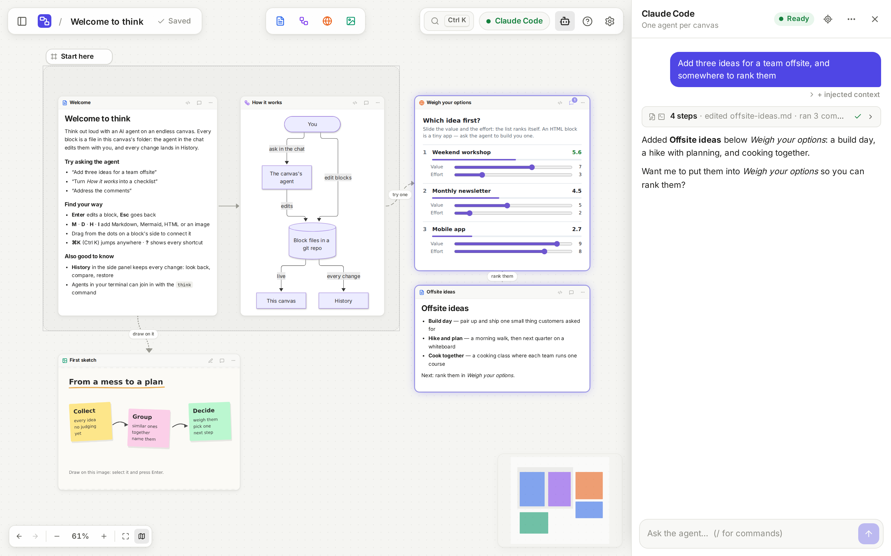
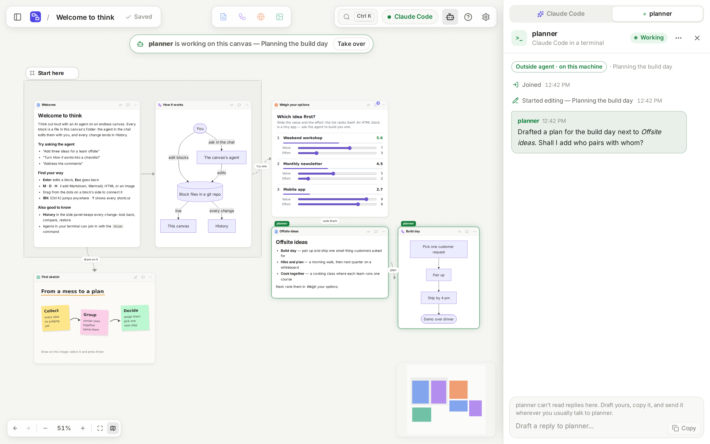
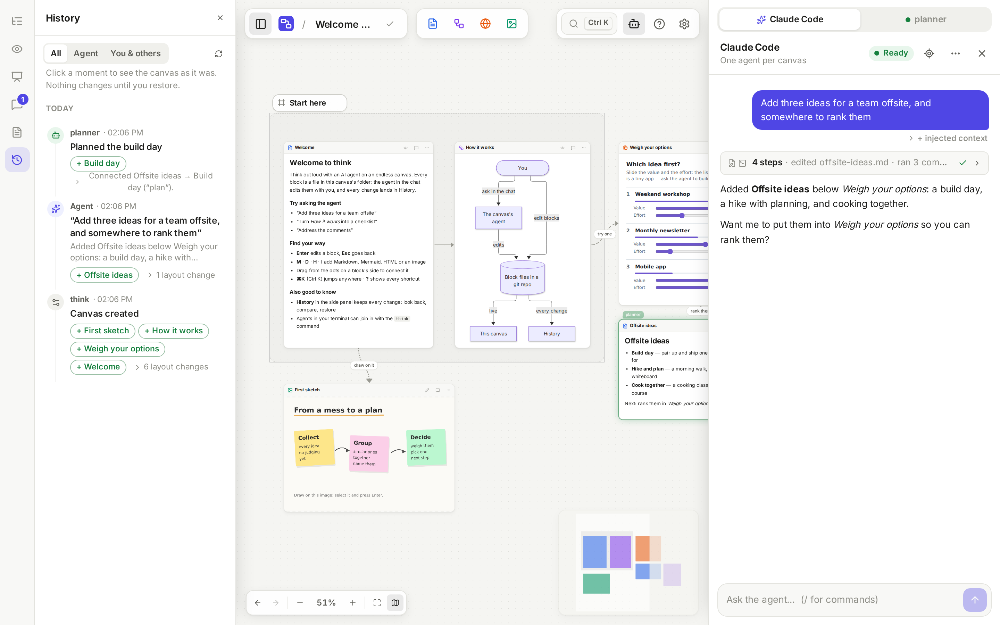
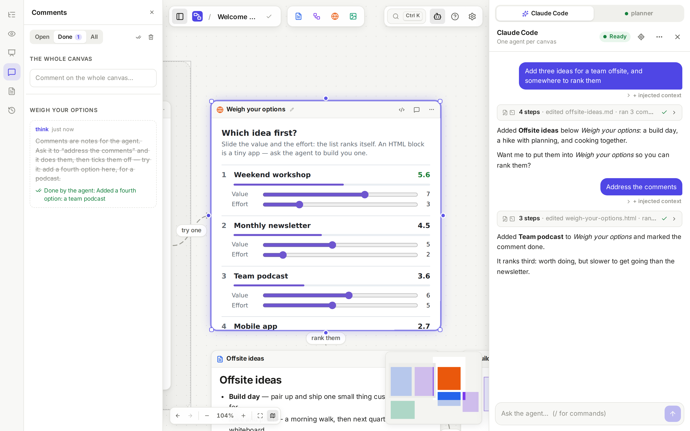
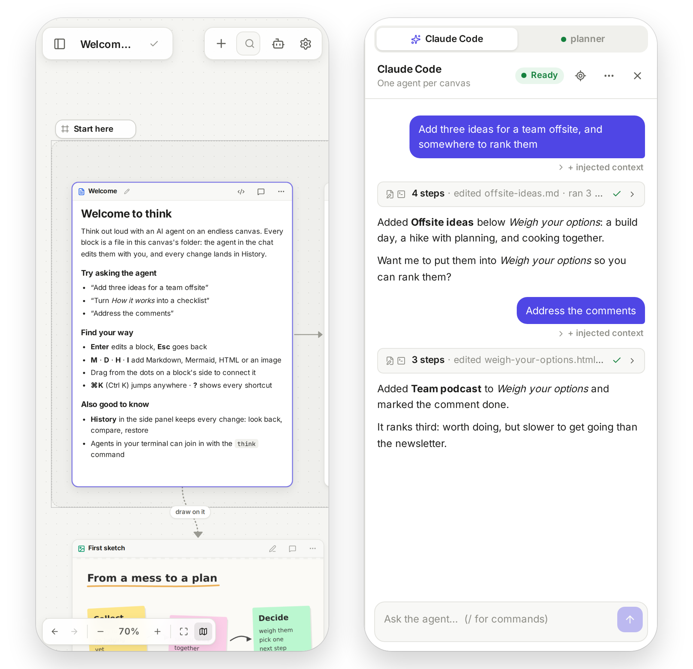
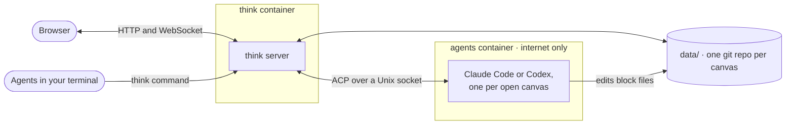
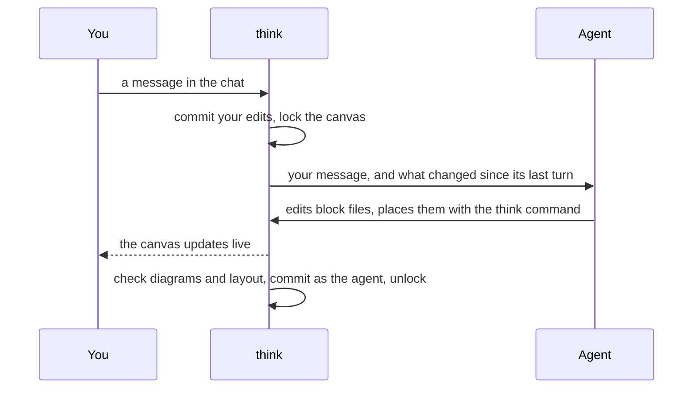

<p align="center">
  
</p>

<h1 align="center">think</h1>

<p align="center"><b>An agentic canvas where the board is just files.</b></p>

<p align="center">
  <a href="https://github.com/olalha/think-board/actions/workflows/ci.yml"></a>
  <a href="https://github.com/olalha/think-board/releases"></a>
  <a href="LICENSE"></a>
</p>

Every block on a think canvas is a real file — Markdown, Mermaid, HTML, images —
and the canvas is a live view of a folder that is a git repository. So any
coding agent can work on it: each canvas has its own (Claude Code or Codex), and
agents in your terminal join with one command. One `docker compose up` runs it
on your laptop or a server.

<picture>
  <source media="(prefers-color-scheme: dark)" srcset="docs/images/canvas-dark.png">
  
</picture>

> [!NOTE]
> **About the history of this repository:** think started as a private project
> on my own server, and its early commits were tangled up with that server's
> setup. Rather than publish those details, this repository starts from a clean
> snapshot.

## What it does

- **Blocks are files.** `trip-ideas.md` is the block “Trip ideas”; the layout is
  `canvas.json` ([JSON Canvas](https://jsoncanvas.org)). Edit them in the app,
  in your editor, or ask an agent — the canvas follows the folder live.
- **An agent per canvas.** Ask in the chat: it edits the files directly and the
  canvas updates live. Leave comments on blocks and it works through them.
  Switch a canvas between Claude Code and Codex at any time, in a new
  conversation.
- **Any agent can join.** An agent that can edit files and run a command —
  Claude Code, Codex or another — works on a canvas with the `think` command,
  in a tab of its own in the chat.
- **Every change is kept.** Each edit — yours, the agent's, anyone's — is a git
  commit. History previews any moment and restores it.
- **Made for thinking:** frames, links, saved views and a presentation mode,
  drawing on images, quick jump (⌘K), and a phone layout for reading and
  chatting.
- **Yours to run.** Two Docker containers and one data folder. The agents run
  isolated in their own container and sign in with your Claude or ChatGPT plan,
  or an API key.

## A closer look

| Agents from your terminal join in | Every change is kept, by whom |
|---|---|
|  |  |
| **Comments the agent works through** | **On your phone** |
|  |  |

## Quick start

You need Docker with Compose, and a Claude or ChatGPT subscription (or an
Anthropic or OpenAI API key) for the agents.

```bash
mkdir think && cd think
curl -fsSLO https://raw.githubusercontent.com/olalha/think-board/main/deploy/compose.yml
docker compose up -d
```

Open http://localhost:8080 and start with the canvas *Welcome to think*. To sign
the agent in, open a canvas: the chat shows **Log in**. Your canvases are plain
folders in `./think-data` — back them up.

To build from source instead:

```bash
git clone https://github.com/olalha/think-board.git && cd think-board
docker compose up -d --build
```

**On a server**, put authentication in front: think has an optional built-in
password, and anyone who can open it can talk to agents that run commands.
think has no user accounts: everyone who gets in sees every canvas and uses the
same agent sign-ins.
[docs/install.md](docs/install.md) covers reverse proxies, Dokploy and
Coolify, the password, API keys and updates.

## How it works



A turn, from your message to the canvas:



## Documentation

- [Installing and running](docs/install.md) — Docker, reverse proxies, Dokploy, the password, agents, updates
- [Architecture](docs/architecture.md) — how the pieces fit, the canvas format, isolation
- [Outside agents](docs/outside-agents.md) — the `think` command for agents on your machine
- [Configuration](docs/config.md) and [prompt templates](docs/prompts.md)
- [Development](docs/development.md) — running from source, tests, screenshots, releases

## Contributing

Issues and pull requests are welcome — see [CONTRIBUTING.md](CONTRIBUTING.md).
To report a security problem, see [SECURITY.md](SECURITY.md).

## License

[MIT](LICENSE)
